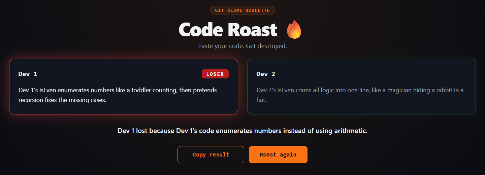

# Code Roast 🔥

Two developers lock in their code blind, an AI senior tech lead roasts both, and one of them walks away the LOSER.

**[Live demo](https://code-roast-4zag.vercel.app)**



## How it works

1. **Turn-based blind mode:** Dev 1 enters a name and code, then locks in and passes the screen to Dev 2. Neither player sees the other's code before the roast.
2. **Code vault:** Locked code is sealed behind a "CLASSIFIED UNTIL ROAST" vault that shows only the line and character counts.
3. **Turn timer:** Choose No Limit, 30s, 1m, 2m or 5m before the match. The clock starts when the player begins typing and locks the turn automatically at zero. A player who wrote nothing gets a time-expired placeholder and an extra harsh roast.
4. **AI tech-lead roast:** Both snippets go to a serverless function, which asks a Groq-hosted model to roast naming, complexity, bugs and style. The roast stays about the code, not the person.
5. **LOSER reveal:** The two roasts appear side by side. The loser's card shakes and glows red under a "LOSER" badge, followed by the verdict. The animation respects `prefers-reduced-motion`.
6. **Copy result:** One click copies a short summary with both names, the loser, the verdict and the site URL.

Limits: names can be up to 30 characters, code up to 4000 characters, and the two names must be different.

> Your code is sent to a third-party AI service, so don't paste secrets or API keys.

## Tech stack

- **Frontend:** React + Vite (JavaScript)
- **Backend:** Vercel serverless function (`api/roast.js`)
- **AI:** Groq chat completions API with the `openai/gpt-oss-120b` model in JSON mode

## Run locally

Just want to play? Use the live demo above. These steps are for running the code on your own machine.

You need Node.js, the [Vercel CLI](https://vercel.com/docs/cli) and a [Groq API key](https://console.groq.com/keys).

1. Clone the repository and install the dependencies:

   ```bash
   git clone https://github.com/cinarkyo/code-roast.git
   cd code-roast
   npm install
   ```

2. Create a `.env` file in the project root:

   ```env
   GROQ_API_KEY=your_groq_api_key_here
   ```

   The key is only used on the server. `.env` is ignored by git, so never commit it.

3. Install the Vercel CLI if you don't have it, then start the app:

   ```bash
   npm install -g vercel
   vercel dev
   ```

4. Open <http://localhost:3000>.

> **Note:** `npm run dev` starts only the Vite frontend. It won't run `/api/roast`, so roasts will fail. Use `vercel dev` for the full app.

## Project structure

```text
code-roast/
├── api/
│   └── roast.js              # Serverless function: validates input and calls Groq
├── public/                   # Static assets, including the favicon
├── src/
│   ├── components/
│   │   ├── CodePanel.jsx     # Player panel: editor, code vault and turn timer display
│   │   ├── MatchSettings.jsx # Turn status, timer picker and match reset
│   │   ├── ResultView.jsx    # Roasts, LOSER reveal, verdict and copy result
│   │   └── ResultView.css
│   ├── services/
│   │   └── roastClient.js    # Frontend call to /api/roast
│   ├── App.jsx               # Match flow and app state
│   ├── App.css
│   ├── index.css             # Global theme
│   └── main.jsx              # App entry point
├── index.html
└── package.json
```

## How we worked

- **GitHub issues:** We tracked the work as issues.
- **Feature branches:** Changes were built on feature branches.
- **Pull requests with reviews:** Changes were reviewed in pull requests.
- **Protected main:** `main` is protected, and changes go through pull requests.

## Authors

- Çınar
- Zafer
